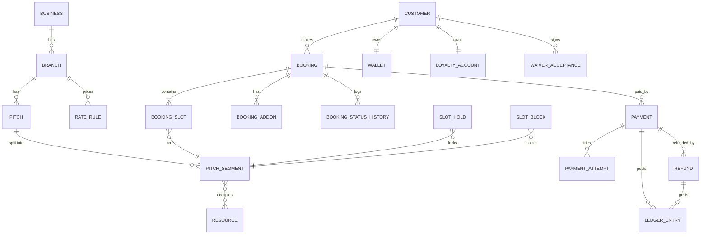
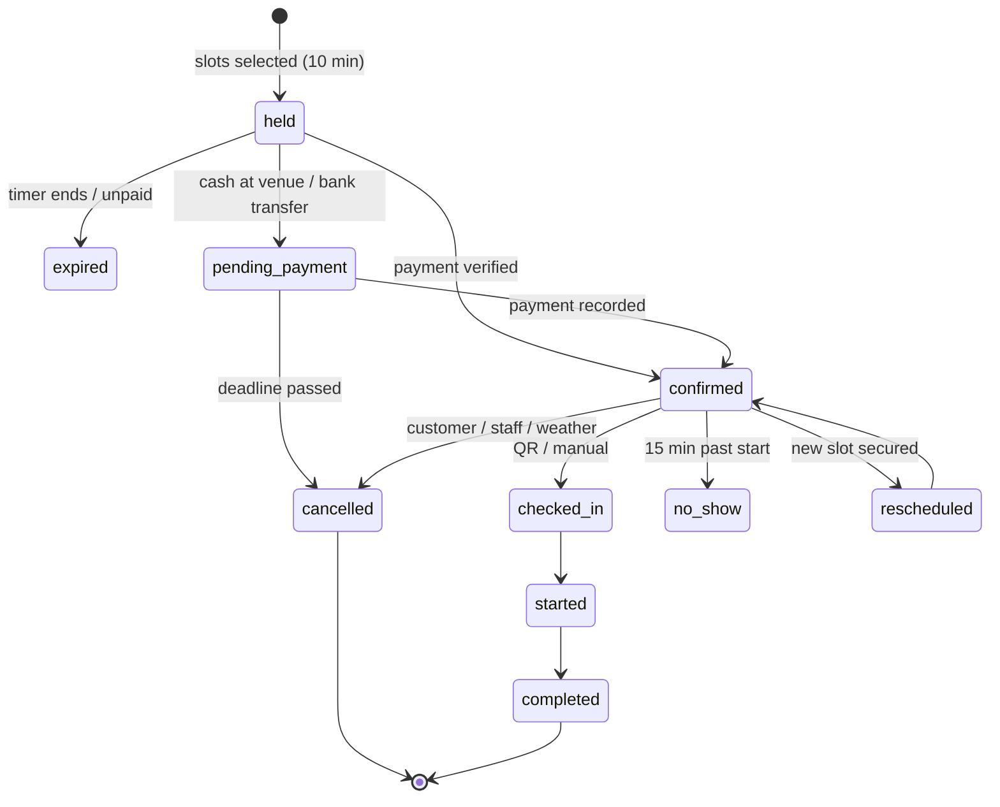
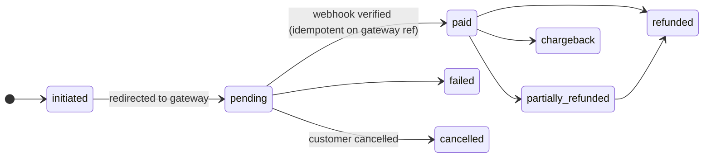
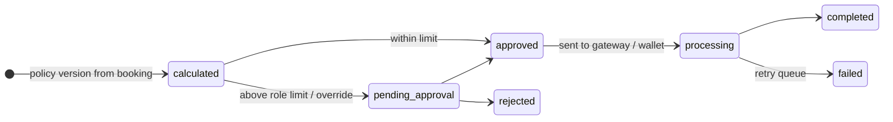

# Architecture hand-off

This document shows how the HTML template maps to a production system. It is the contract for the
developers who will build the backend. The template's screens, field names and statuses follow it.

## Recommended stack

| Layer | Choice | Notes |
|---|---|---|
| Web app | Next.js (App Router) + TypeScript | Reuse `src/assets/css` as-is or port tokens to Tailwind. SSR for public pages; `/bn/*` routes for Bangla SEO |
| API | REST under `/api/v1` (see `docs/docs-api.html` or the live site) | Service layer per domain; Zod validation; OpenAPI generated from schemas |
| Database | PostgreSQL 15+ | Exclusion constraints for slot conflicts, append-only ledger, row-level branch scoping |
| Cache / locks / queues | Redis + BullMQ | Short slot locks, hold expiry, webhook / notification / report workers |
| Storage | S3-compatible (R2/S3) + CDN | Photos (WebP/AVIF), receipts, documents; malware scan on upload |
| Auth | Phone OTP (customers), password + TOTP (staff), API keys with scopes | Sessions in HTTP-only cookies; device list and revocation |
| Observability | Sentry, uptime monitor, structured logs | Audit log is separate from app logs |
| Environments | local (Docker Compose) → staging (sandbox gateways) → production | Automated migrations, blue/green or rolling deploy with rollback |

## Core data model (abridged)

Every operational table carries `branch_id`, so the system is multi-branch from day one. Money is stored as
integer **paisa** in BDT. Times are `timestamptz`, displayed in Asia/Dhaka.



The template also uses these entities: SlotTemplate, OperatingHours, Holiday, Team/TeamMember, OpenMatch/Request,
Coupon/CouponUsage, Membership, Package/PackageUsage, Waitlist, Tournament/TournamentTeam/Fixture/MatchResult/ScoreEvent,
Sponsor, AcademyProgram/Batch/Student/Attendance, CorporateAccount/Contract, Product/InventoryItem/StockMovement,
Supplier/PurchaseOrder/GoodsReceipt, Rental/RentalItem, Expense, Staff/Role/Permission/Shift/Attendance/Leave/Payroll,
Asset, MaintenanceTask, Incident, SupportTicket, Notification/Template/Campaign, CMSPage/BlogPost/Review,
AuditLog, IntegrationLog, BranchSetting/SystemSetting. These match spec §43.

## Double-booking prevention

Pitch A can be booked **full** or as **Half 1 / Half 2**. Each half is modelled as a physical *resource*.
The full pitch occupies both resources, and each half occupies one. One exclusion constraint then covers every rule:

```sql
CREATE EXTENSION IF NOT EXISTS btree_gist;

-- one row per (booking slot | hold | block) × physical resource it occupies
CREATE TABLE resource_occupancy (
  id            bigserial PRIMARY KEY,
  resource_id   bigint      NOT NULL REFERENCES resource(id),
  during        tstzrange   NOT NULL,
  source_type   text        NOT NULL CHECK (source_type IN ('booking','hold','block')),
  source_id     bigint      NOT NULL,
  released_at   timestamptz,
  EXCLUDE USING gist (resource_id WITH =, during WITH &&) WHERE (released_at IS NULL)
);
```

| Rule (spec §9) | How it's enforced |
|---|---|
| Two customers never book the same pitch/time | Exclusion constraint |
| Full blocks both halves; a half blocks full; two halves coexist | Full occupies resources {H1, H2}; halves occupy one each |
| Holds lock slots during checkout | `hold` rows in the same table + Redis `SET NX PX` fast-path lock; worker releases expired holds |
| Payment after hold expiry | If the slot is still free, confirm inside a transaction; otherwise route to the exception queue and auto-refund |
| Maintenance / tournament blocks override availability | `block` rows in the same table |
| Recurring bookings detect future conflicts | Insert all occurrences in one transaction; on 409 return the clashing dates |
| Reschedule releases old slot only after the new one is secured | Single transaction: insert new occupancy → set `released_at` on old |
| Staff bookings follow the same rules | Same service + constraint; overrides only change price, never conflicts |
| Every conflict attempt is logged | Catch `23P01` (exclusion_violation) → write `booking_conflict_log` |

## State machines







## Money rules

- **Ledger is append-only.** Revoke `UPDATE`/`DELETE` on `ledger_entry` from the app role. Corrections are reversal rows that point to the original (`reversal_of`).
- Every payment, refund, POS sale, wallet movement and expense posts a ledger entry in the same transaction as the business change.
- Webhooks: verify signature → insert into `payment_webhook` (unique `(gateway, gateway_ref, event)`) → enqueue. A duplicate insert means "already processed" and returns 200.
- Pricing priority (configurable): special date → holiday → weekend band → weekday time band → fallback. Adjustments then run in order: floodlight, membership/corporate/student, package hours, coupon, then tenders (wallet, points). Incompatible discounts follow the stacking matrix; the larger saving wins.
- The cancellation policy version and waiver version are stored on each booking at acceptance time.

## Permissions

Permissions are `domain.action` strings (see Admin → Permissions), granted to roles, with a branch scope per
user. Every API handler calls `authorize(user, 'refunds.issue', { branchId, amount })`. Amount-based limits
(refunds, discounts) and sensitive actions (price override, ledger reversal, payroll view, PII view, export) are
checked on the server and written to the audit log. Hiding a button in the UI is never the only protection.

## Security checklist (spec §37–38)

Argon2id password hashing · OTP 5-minute expiry, 5 attempts / 15 min, per-phone + per-IP limits · TOTP for all
admin roles · CSRF tokens on cookie sessions · strict CSP · parameterised queries only · upload type sniffing +
size limits + malware scan · secrets in a KMS/secret manager · TLS everywhere, encryption at rest for medical
notes and documents · PII masking by permission · audit logs for login, refunds, price changes, exports, backups
· nightly encrypted backups + monthly restore drill · consent records with policy version and timestamp ·
data export & anonymisation jobs.
